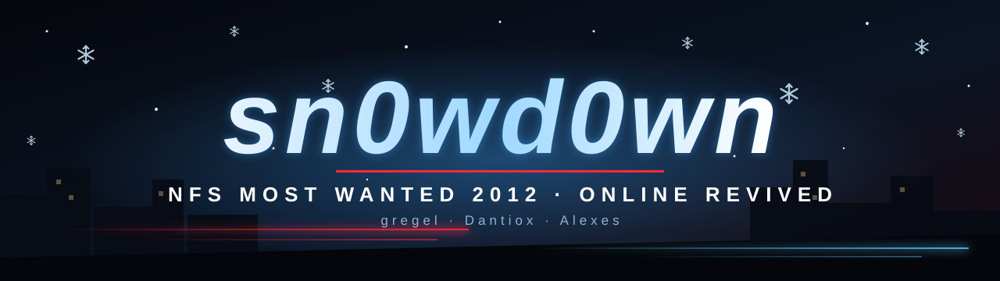
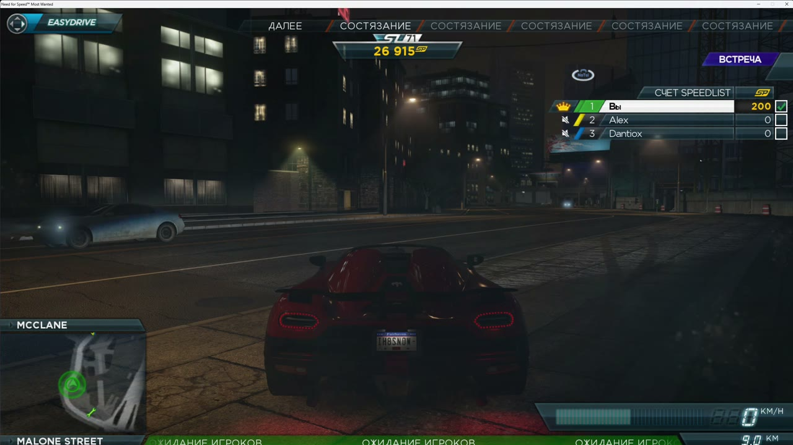

<p align="center">
  
</p>

# nfs13

> [!IMPORTANT]
> ## LEGAL COPY OF THE GAME REQUIRED
> **Use this project ONLY with a legally acquired copy of Need for Speed: Most Wanted (2012).**
> This project does not provide, distribute, or authorize pirated copies of the game. You must supply your own legitimate game installation. The server and client patcher are intended solely for interoperability with your own copy.

Self-hosted online server for **Need for Speed: Most Wanted (2012)** on PC.

It brings back the game's online mode for you and your friends: logging in,
EasyDrive, free roam with other players, speedlists and Autolog. We have played
three-player sessions with full speedlists on it.

Made by **sn0wd0wn**: gregel, Dantiox and Alexes (see [AUTHORS](AUTHORS)).

[](https://www.youtube.com/watch?v=gprfBzVMjnw)

▶ **[Watch the gameplay video](https://www.youtube.com/watch?v=gprfBzVMjnw)**: three players online, free roam and a speedlist on this server.



## What works

| Feature | State |
| --- | --- |
| Online login, EasyDrive, online menus | Works |
| Free roam with up to 12 players (tested with 3) | Works |
| Speedlists: five events picked at random, voting | Works |
| License plates (saved on the server) | Works |
| Player names (chosen by each player) | Works |
| Live speedlist score during the events | Works |
| Online level, free roam SP counter, end-of-speedlist results | Not yet: the server does not send `ResultNotification` |
| Host migration | The new host does not restart the speedlist |
| Friends, Autolog recommendations, speedwall records | Placeholder answers only |

## How it fits together

The full picture, with diagrams of login, joining and speedlists, is in
[docs/HOW_IT_WORKS.md](docs/HOW_IT_WORKS.md).

```
 game (patched NFS13.exe)
   │  DNS: *.ea.com names → your server (hosts file)
   ├── TCP 42127  Blaze (SSLv3) ─┐
   ├── TCP 44125  HTTPS (SSLv3) ─┤ stunnel-ssl3 → server.py
   ├── TCP 8080   Autolog HTTP  ─┘
   ├── TCP/UDP 17500  QoS
   └── UDP 3659  directly between players (peer to peer)
```

`server.py` is a single Python file with no dependencies. It answers the Blaze
RPCs the game uses (authentication, user sessions, game manager, stats, game
reporting) and Autolog's HTTP API. Players connect to each other directly, so
every player must be able to reach every other player over UDP: same LAN, or a
VPN such as WireGuard.

## Server setup (Linux)

Requirements: Python 3.10 or newer, OpenSSL, and Docker to build an SSLv3
capable stunnel (the game cannot speak anything newer).

```bash
git clone https://github.com/178lavash178-create/nfs13
cd nfs13
./install/install_server.sh 192.168.1.50      # the IP players use to reach the server
```

The script copies the server to `~/nfs13-server`, builds `stunnel-ssl3`,
creates a self-signed certificate and starts two systemd user services.
Then open TCP 42127, 44125, 8080, 17500 and UDP 17500.

Watch the server live:

```bash
journalctl --user -u nfs13-server.service -f -o cat
```

To run it by hand instead: `NFS13_HOST=192.168.1.50 python3 server/server.py`
together with stunnel using `server/frontend/stunnel.conf.in`.

## Client setup (Windows or Linux with Proton)

1. **Patch your own copy of the game.** The patcher works only on the exact
   `NFS13.exe` we built it from and writes `NFS13.online.exe` next to it.
   It never changes the original file.

   ```bash
   python client/patch_nfs13.py "D:\Games\Need for Speed Most Wanted\NFS13.exe"
   ```

   Supported `NFS13.exe`: size 13 672 448 bytes,
   SHA-256 `9571280bb8868cd254e95442181d7bf1d6eafb2156a95d0c38337c7470762c0f`.

2. **Point the EA names at your server.** Add one line per name from
   [client/hosts.txt](client/hosts.txt) to your hosts file
   (`C:\Windows\System32\drivers\etc\hosts` or `/etc/hosts`):

   ```
   192.168.1.50 gosredirector.ea.com
   192.168.1.50 nfs13-pc.blaze.ea.com
   ...
   ```

   If you use a proxy with fake-IP DNS (Clash, Mihomo and similar), the hosts
   file is the reliable way: keep these names and UDP 3659 out of the proxy.

3. **Start `NFS13.online.exe`** and choose online play.

### Choosing your name

Players are told apart by IP address and get `Player1`, `Player2` and so on.
Pick your own name from your computer; it applies the next time you go online:

```bash
curl "http://192.168.1.50:8080/rename?name=YourName"
```

Names are 1–15 Latin letters, digits, `_` or `-`.

## Repository

| Path | What it is |
| --- | --- |
| `server/server.py` | The server |
| `server/test_server.py` | Tests: `python3 -m unittest test_server` from `server/` |
| `server/frontend/` | Dockerfile for the SSLv3 stunnel and its config template |
| `install/install_server.sh` | Server installer for Linux |
| `client/patch_nfs13.py`, `client/patches/` | Client patcher and the patch bytes |
| `client/hosts.txt` | Names to redirect |
| `client/trace_hook/` | Optional `d3d11.dll` proxy that logs the game's network code, by Dantiox |
| `docs/` | How the protocol work was done, what is still open |
| `logs/` | Real server logs of three-player sessions (3 and 4 November 2026) |

## Not included

No game files. You need your own copy of Need for Speed: Most Wanted (2012).
Memory dumps of the game are not published either: they contain the game's code.

## Security and compatibility warnings

- **Legacy transport security:** The original game uses SSLv3, an obsolete and insecure protocol. This project uses it for compatibility only. Do not treat these connections as secure or expose sensitive credentials through them.
- **Client certificate verification:** The optional client patch skips the game's server certificate check to allow a self-signed server certificate. This removes an important authenticity check. Only connect to servers you trust, preferably over a private LAN or VPN.
- **Executable modification:** The patcher changes executable bytes in a locally owned copy of `NFS13.exe`. It is version-specific, unsupported by EA, and may trigger security software or violate applicable terms. Review the patch and understand the risks before using it.
- **No official account required for this private server:** The patched login path is not an official EA authentication service. Do not enter EA account passwords or other sensitive credentials into community-hosted services.
- **No security guarantee:** Run the server in an isolated environment, keep access limited to trusted users, and do not expose unnecessary ports to the public internet.

## Legal

This is an independent, unofficial, non-commercial fan preservation and interoperability project. It is **not affiliated with, authorized by, sponsored by, or endorsed by Electronic Arts or Criterion Games**. *Need for Speed* and *Most Wanted* are trademarks of Electronic Arts Inc.

**You must obtain and use your own lawfully acquired copy of Need for Speed: Most Wanted (2012).** No game executable, proprietary game assets, or EA source code are distributed in this repository. The client patcher only operates on a user's existing executable.

Reverse engineering, modifying executables, and bypassing authentication or technical protection mechanisms may be restricted by copyright law, anti-circumvention rules, and the game's terms of service. Laws vary by jurisdiction. This project makes **no claim that every use is legally permitted**; users are responsible for checking applicable law and agreements. This notice does not grant any rights to EA's intellectual property.

Our original project code is licensed under the [GNU Affero General Public License v3.0](LICENSE).

Copyright (C) 2026 sn0wd0wn (gregel, Dantiox, Alexes).
