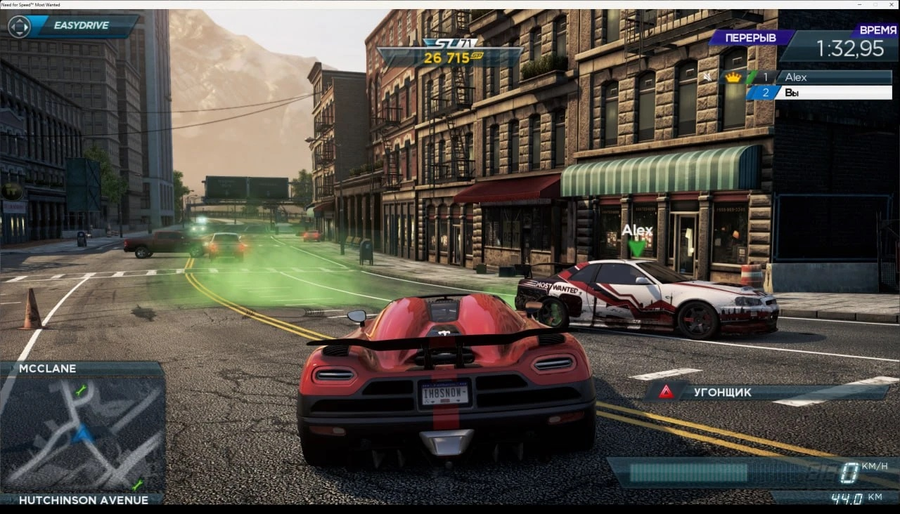
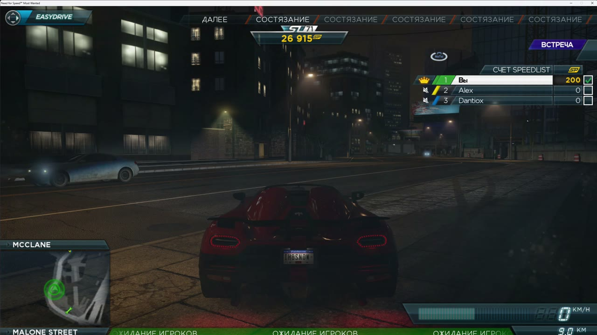
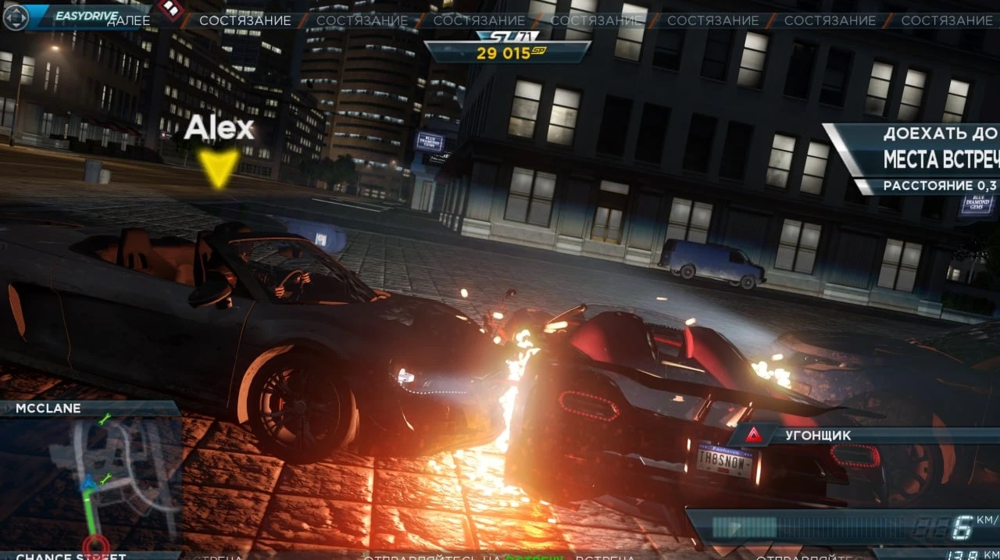
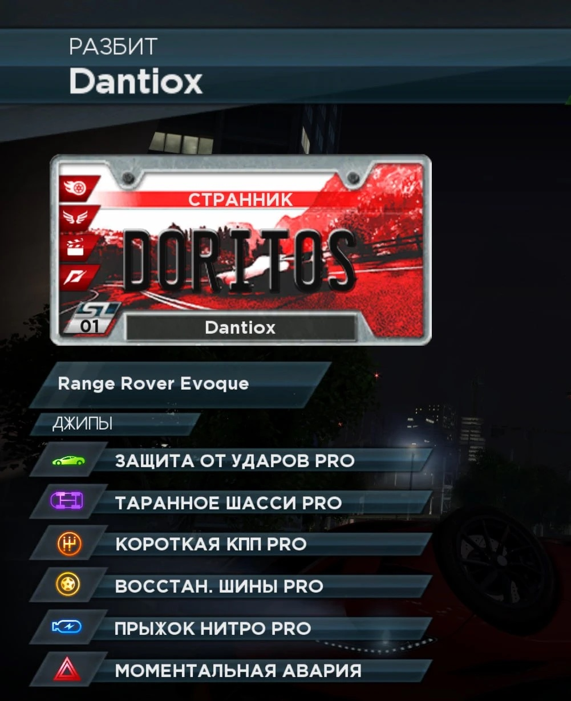

# Evidence that it works

Everything below comes from our own server and game PCs, 1–5 November 2026.
Logs are unedited except that IP addresses were replaced (`10.13.x.x`, numbered
separately in each file) and Autolog session tokens were removed.

## In numbers

From [SESSIONS.md](SESSIONS.md), built from the full server event log:

* **44 sessions**, **32 with two or more players**, **14 with three players**
* **15 hours** of multiplayer time
* **19 speedlist events** played, **685 game reports** received
* First three-player session: **2 November 2026, 21:11 UTC**

## Video

[](https://www.youtube.com/watch?v=gprfBzVMjnw)

Three players on this server: free roam, a random speedlist, meet-ups, a drift
event with the live score of all three players, takedowns. The matching server
log is [logs/session-2026-11-04.log](../logs/session-2026-11-04.log).

## Screenshots

| | |
| --- | --- |
|  |  |
| Free roam during the break before a speedlist: the timer and the standings come from the session the server set up. | Meet-up before the first event, live speedlist score of three players. |
|  |  |
| A takedown on the way to the meet-up, other player's name above the car. | Wrecked by Dantiox: his custom license plate and car come from the server. |

## Server logs

| File | What it shows |
| --- | --- |
| [server-events-2026-11-01_05.log](../logs/server-events-2026-11-01_05.log) | Every session event of five days: games created, players joining, host changes, speedlist requests, attribute changes, game reports |
| [first-three-player-session-2026-11-02.log](../logs/first-three-player-session-2026-11-02.log) | The first session with three players, full log |
| [speedlist-session-2026-11-03.log](../logs/speedlist-session-2026-11-03.log) | A full five-event speedlist with three players |
| [session-2026-11-04.log](../logs/session-2026-11-04.log) | The session in the video, random speedlist |

## Client logs (trace hook on the host PC)

These show the game's side: what it accepted and what it did with it.

| File | What it shows |
| --- | --- |
| [04-mesh-three-players-2026-11-02.log](../logs/client/04-mesh-three-players-2026-11-02.log) | Session setup and peer-to-peer connections up to `AddClient` for each player |
| [01-speedlist-rejected-2026-11-03.log](../logs/client/01-speedlist-rejected-2026-11-03.log) | Before the fix: `Parse result=0`, no event accepted, the host leaves |
| [02-event-table-2026-11-03.log](../logs/client/02-event-table-2026-11-03.log) | The game's own table of 420 valid event ids |
| [03-speedlist-accepted-2026-11-03.log](../logs/client/03-speedlist-accepted-2026-11-03.log) | After the fix: `Parse result=1`, 7 events accepted |

## Game reports

[GAME_REPORTS.md](GAME_REPORTS.md) shows real reports the game sent after
events, decoded field by field (event id, players, score, XP, takedowns,
wrecks, distance, time).

## Reproduce it yourself

```bash
(cd server && python3 -m unittest -v test_server)   # 48 protocol tests
python3 tools/session_summary.py logs/server-events-2026-11-01_05.log
grep "getComponent=playlist" logs/speedlist-session-2026-11-03.log
# decode the first OnlineEventChallenge report (a finished speedlist event)
grep "comp 0x001C, cmd 0x0002" logs/speedlist-session-2026-11-03.log \
  | grep -m1 "4f 6e 6c 69 6e 65 45 76 65 6e 74 43 68 61 6c" | python3 tools/tdf_decode.py -
```

The tests also run on every push (GitHub Actions badge in the README).
