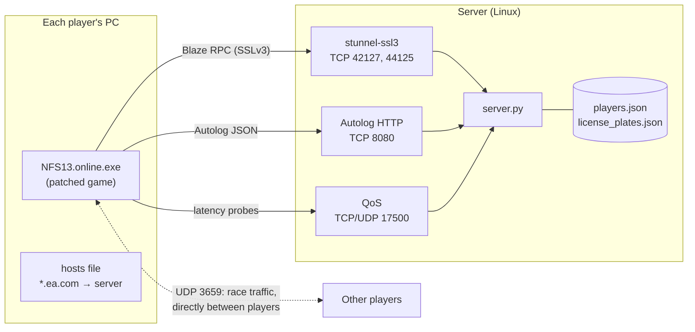
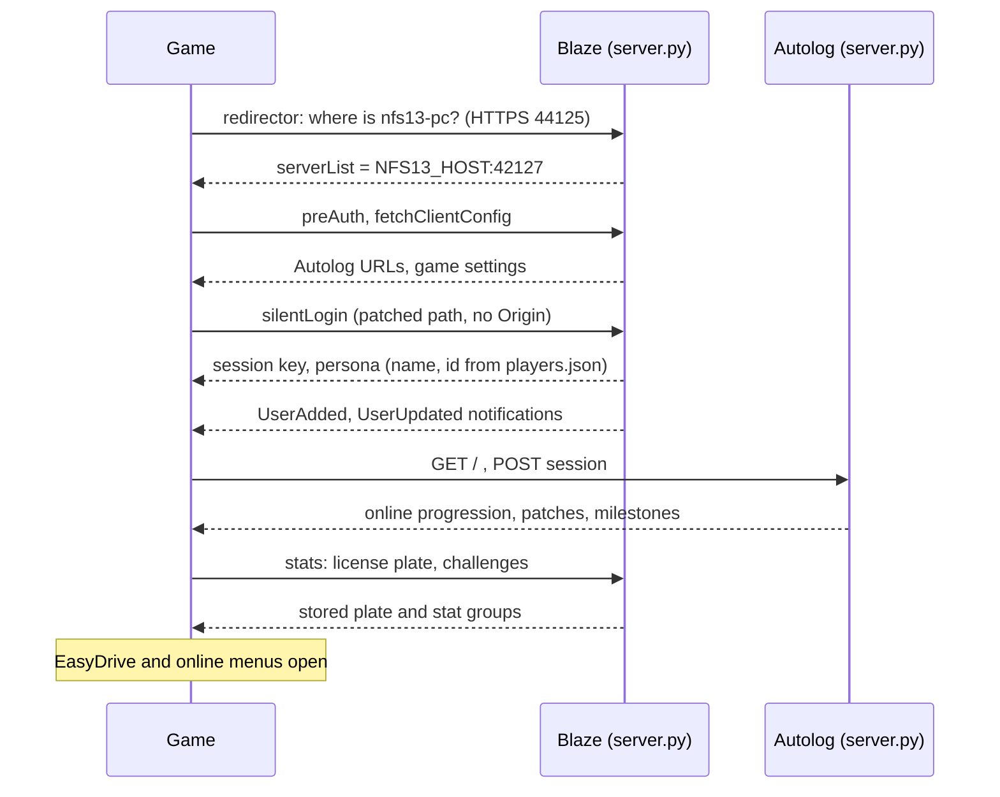
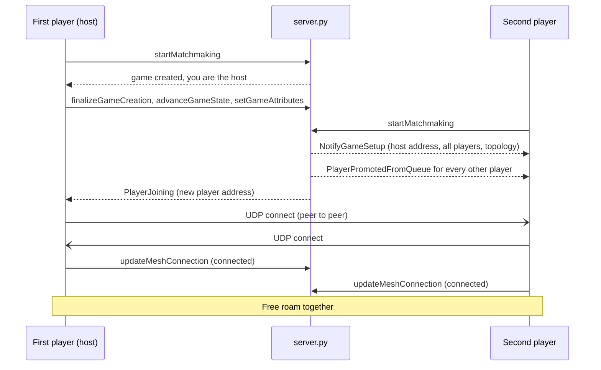
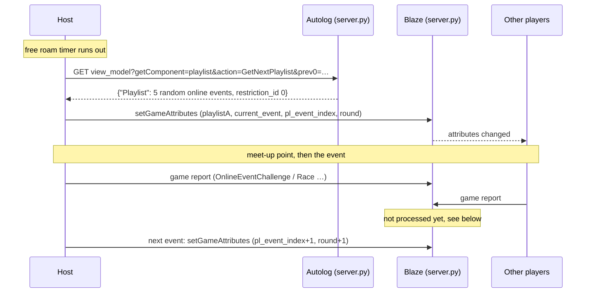

# How it works

The official servers spoke three things to the game: **Blaze** (EA's RPC
protocol over SSLv3), **Autolog** (JSON over HTTP) and **QoS** (latency
probes). `server.py` answers all three. Races themselves are not run by the
server: the players' games connect to each other and one of them hosts.

## Overview



* **stunnel-ssl3** ends the SSLv3 connection and passes the player's real IP
  to `server.py` with the PROXY protocol. The IP is how the server tells
  players apart.
* **server.py** keeps the player list, the sessions (games) and what each game
  needs to know about the others, and sends the notifications the game waits
  for.
* **Peer to peer.** After the server introduces the players, their games talk
  directly over UDP. The server never sees race traffic, which is why every
  player must be able to reach every other one.

## Going online



The original game logs in through Origin. The client patch sends the login
down the game's own Blaze `silentLogin` path instead, so no Origin login is
involved, and accepts the Autolog session that results.

## Joining a session



The host owns the session state. Everything the host changes (current event,
speedlist, round) goes to the server as game attributes, and the server relays
it to the other players.

## Speedlists



* Events are drawn from the 85 online events found in the game's own event
  table. Events listed in `prev0…prev9` (the last speedlist) are skipped.
* `restriction_id` must be present. Without it the game reads an uninitialised
  value and asks players to switch to a car that does not exist.

## Game reports and what is missing

After every event, and from time to time in free roam, each game sends a
report: event id, score (SP), XP, takedowns, wrecks, distance and time.

```
GTYP = 'OnlineEventChallenge'
RSLT  EVID = 1430729  NUMP = 3  SCOR = 125516
STAT  SCOR = 3000  XP = 29215  TKDS = 0  WRCK = 3  DDRV = 3172  PLYT = 136
```

The real server processed these and answered with `ResultNotification`
(Blaze notification `0x1C/0x72`). We accept the reports but do not answer
yet, so online level, the free roam SP counter and the speedlist results screen
stay empty. That is the next big piece of work.

## The client patch

`client/patches/nfs13_online.json` holds 37 byte ranges, 301 bytes in total.
They do the following:

| Change | Why |
| --- | --- |
| Route the Origin login state to Blaze `silentLogin`; restore the `logout` RPC | No Origin account is needed to go online |
| Accept the Autolog session state 10 as well as 11 | After the local login cycle the session ends in state 10 and was rejected |
| Small code cave at the end of `.text`, section marked writable | Keeps the Autolog session alive across logins |
| Skip the server certificate check in DirtySock's ProtoSSL | Lets the game use a self-signed certificate |

## How it was found

Blaze messages are tagged binary structures (TDF). The game drops a message
silently if one field has the wrong type, so the work was mostly finding which
field the game was waiting for. Some TDF member tables are filled in at run
time and are cut short in the exe file, so the full layout was read from
memory dumps of the running game (row: flag, 3-byte tag, field kind, row size,
offset).

| Step | Fix | How it was confirmed |
| --- | --- | --- |
| 1–2 | `onlineProgression` in the Autolog answer | memory dump |
| 3 | `Patches` and `milestonePatches` | error turned into waiting |
| 4–5 | stats notification 50; key `No_Scope_Defined` for `license_plate` | crash at 0x006EE448 gone |
| 7–8 | `DMAP`, `USID` in user data updates | reading handler 0x00C04480 |
| 9 | `CVAR` is type 7, not a list: the wrong type broke the whole message | dump |
| 10 | `UserAuthenticated` following `UserSessionLoginInfo` | dump: local user got id and name |
| 11 | answer to `filterForProfanity` | crash at 0x00A87C84 gone |
| 12 | DoubleSP bonuses marked as granted | `startMatchmaking` appeared |
| 13 | `QDAT`/`NQOS` closed, address without `NLMP` | host address reached the client |
| 15 | `PlayerPromotedFromQueue` for every other player | trace hook: reached `AddClient` |
| 16 | topology `0x84` → `0x82` | first three-player session |
| 17 | speedlist event ids from the game's event table, `restriction_id` | trace hook, full speedlist played |

The trace hook in `client/trace_hook/` was written for this: it logs the game's
session, mesh and playlist code to `nfs13_trace.log`.

## Open problems

* `ResultNotification`: online level, SP counter, speedlist results.
* Host migration: when the host leaves, the new host does not start the next
  speedlist. Workaround: everyone leaves and the session is created again.
* A short "Connection to Autolog lost" dialog can appear before the first
  search. Pressing OK continues normally.
* Only 5 of the 85 speedlist events have been played so far.
